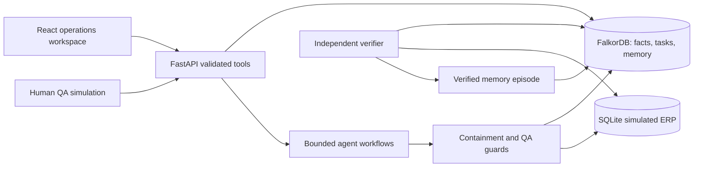

# Architecture

The browser calls a same-origin `/api` route through nginx. FastAPI validates supplier notices with Pydantic, resolves supplier/delivery date/lot scope in FalkorDB, and records immutable source evidence. An indexed common Entity label provides stable IDs alongside domain-specific labels.

## Investigation and coordination

The Change Investigator queries notice-to-lot applicability, batch CONSUMED_LOT records, historical recipe/artwork/declarations, reservations, shipments and customer orders. The policy layer evaluates allergen constraints over query results; it does not construct a substitute graph or infer historical exposure from current recipes. Missing required facts become uncertain. Findings persist in the graph with evidence identifiers and observed timestamps.

The memory agent selects verified, active episodes matching supplier, allergen and causal mechanism. The next agent gets procedural guidance plus explicit rejection of historical lot decisions and approvals. The Recovery Planner persists a ProposedAction and shared AgentTask per batch requiring containment. Tasks link to the QA employee and action prerequisites.

When configured, the OpenAI Agents SDK runs real model tool-calling loops for memory, investigation and recovery; response coordinator and verifier loops execute bounded tools at the corresponding operator stages. The default is model-driven mode when credentials exist; otherwise a transparent local workflow invokes the same graph/ERP tools. Required-tool postconditions prevent a model summary from substituting for execution. Incomplete stages receive a bounded model-driven repair turn, and tool calls run sequentially when they depend on prior evidence. No provider response or reasoning is fabricated. All tools persist invocation, success/failure and elapsed time. Model output is advisory and cannot supply its own authoritative classification or disposition.

## ERP, approvals and verification

Containment re-queries current facts, then writes QA_HOLD records keyed by `(batch, investigation)`. SQLite transactions and application locks prevent local concurrent illegal transitions. Idempotent containment and terminal dispositions avoid duplicate mutations. Dispatch reads graph shipment allocation, checks notice coverage and current exposure, then checks actual ERP state. Missing graph context blocks dispatch.

QA must explicitly select authority, supply a reason and record prerequisite evidence. Release requires supplier reconciliation, label review, quality review and relabeling validation attestations. Unknown lot exposure remains ineligible for release. Disposal requires quality review. Reject/request-evidence decisions preserve holds. Each successful decision is a separate immutable ApprovalDecision node linked to its evidence and authority. ERP audit records successful state transitions. Historical packaging is never rewritten by a disposition.

The verifier independently re-runs source traversal and checks ERP hold coverage, terminal state, graph approval, signoffs and dispatch. It distinguishes verified containment from resolved exposure. A passing verification persists an episode; unresolved QA tasks remain open. The same verifier detects missed writes and unnecessary notice-specific holds. Graph and ERP are separate transactional systems; reconciliation exposes partial cross-store failures.

## Deployment and failures

Compose starts official FalkorDB with a named AOF volume, waits on real health checks, starts the API with automatic idempotent seed, then starts nginx/React. All host ports bind to 127.0.0.1. API graph failures return 503. Startup retries are bounded. Interrupted jobs on restart are marked failed, preserving audit evidence and holds. Reset is explicit, guarded against an active worker and scoped to the dedicated demo stores.

Local single-worker concurrency is intentional. Production identity, distributed job leases, external ERP adapters, machine-verifiable regulatory evidence and transaction outboxes are outside this implementation.
