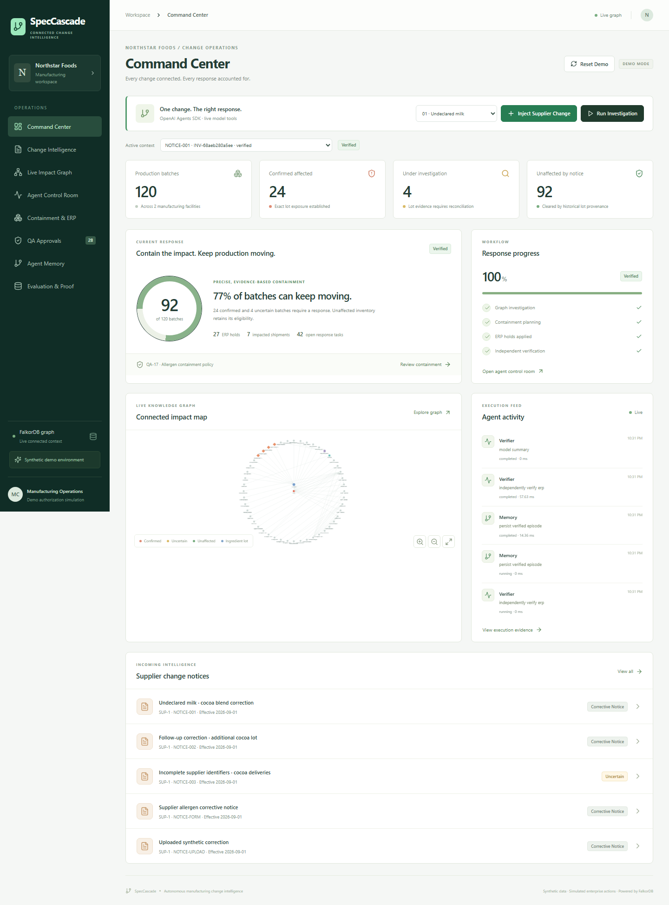
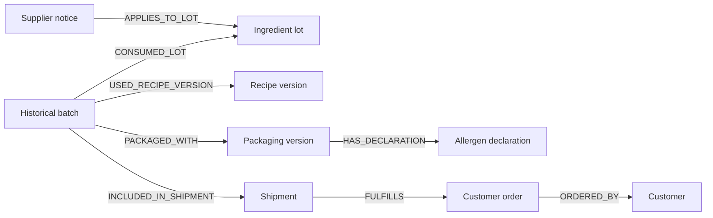
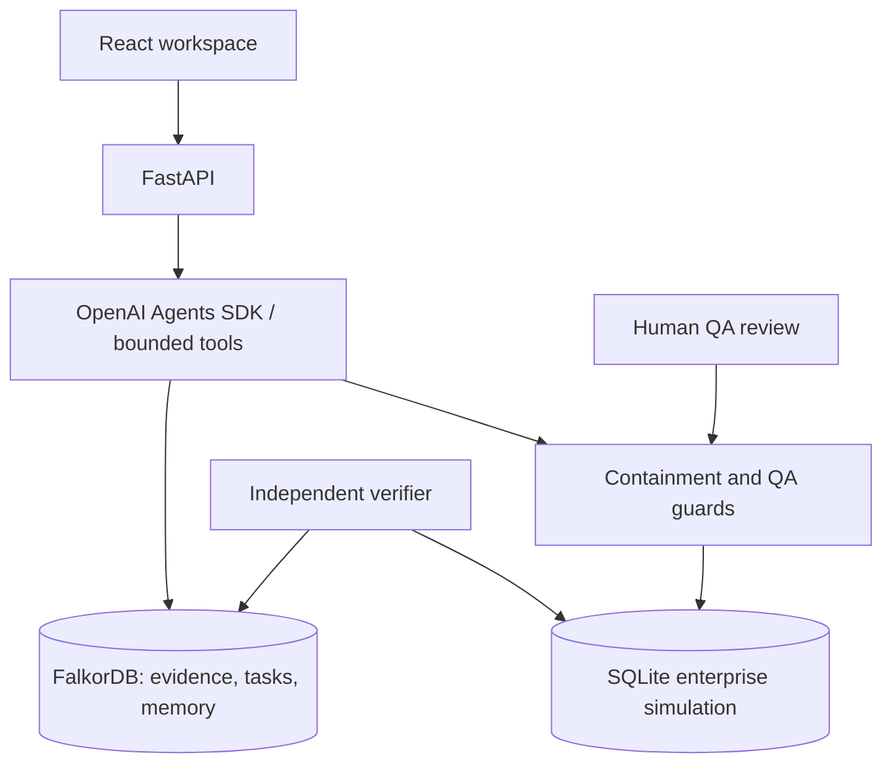

# SpecCascade

### One supplier change. Only the right batches get stopped.

Graph-powered manufacturing change intelligence for food quality teams, built with **FalkorDB** and the **OpenAI Agents SDK**.



[Architecture](ARCHITECTURE.md) · [Graph model](GRAPH_MODEL.md) · [Cypher queries](CYPHER_QUERIES.md)

## The problem

A supplier corrects an allergen declaration. Quality teams must connect delivered ingredient lots to historical production, packaging versions, warehouse stock and customer shipments. Missing a dependency can leave affected inventory moving; a blanket hold interrupts unaffected production.

SpecCascade gives QA, procurement and warehouse teams one evidence-backed response workspace: investigate the change, contain affected inventory, coordinate recovery, authorize disposition, verify execution and remember the outcome.

## Connected evidence into action

- **Investigate:** follow exact lot consumption and the recipe and artwork versions used when a batch was manufactured.
- **Contain:** distinguish confirmed exposure, unresolved evidence and unaffected stock; apply targeted inventory holds and block dispatch.
- **Coordinate:** share findings, assigned tasks and execution events across investigation, response, recovery and verification agents.
- **Review:** require human QA authority, a rationale and supporting evidence before release or disposal.
- **Verify and remember:** reconcile intended actions with actual enterprise state and preserve applicable procedures for future investigations.

The included synthetic manufacturing scenario covers **120 batches: 24 confirmed affected, four uncertain and 92 unaffected**. Twenty-eight require containment. These are controlled scenario outcomes; all manufacturing records, enterprise actions and QA authority are simulations.

## Why FalkorDB

FalkorDB is authoritative for connected manufacturing facts, evidence, findings, shared agent tasks, approvals and persistent memory. Parameterized Cypher traverses historical dependencies rather than assuming that similar recipes share the same exposure.



The OpenAI Agents SDK exposes bounded tools for graph investigation, evidence inspection, memory retrieval, recovery planning, containment and verification. Agents receive actual tool results; completed tool execution is required before a stage succeeds. Verified memories are checked for supplier, allergen and causal relevance, while new lot relationships are investigated afresh. Missing graph context stops dependent operations visibly.

See the [graph model](GRAPH_MODEL.md) and [fourteen Cypher queries](CYPHER_QUERIES.md) for the relationship design and evidence paths.

## Architecture



React, TypeScript and Cytoscape.js provide the operations workspace. FastAPI validates requests. FalkorDB stores connected context; persisted SQLite models inventory, holds, dispatch and the enterprise audit trail. Independent verification checks both stores. [Architecture details](ARCHITECTURE.md).

## Install and run

Requires Docker Desktop with Linux containers, or Docker Engine with Compose. Local ports 5173, 8000, 3000 and 6379 must be available.

```sh
git clone https://github.com/Manikant92/SpecCascade.git
cd SpecCascade
docker compose up --build -d --wait
```

| Service | Address |
| --- | --- |
| Application | http://localhost:5173 |
| API documentation | http://localhost:8000/docs |
| API readiness | http://localhost:8000/api/health |
| FalkorDB Browser | http://localhost:3000 |

Compose starts FalkorDB, initializes the included synthetic manufacturing data when absent, starts the API and serves the frontend through nginx. All host ports bind to `127.0.0.1`.

### Configure the agents

Copy `.env.example` to `.env`, then set your model configuration locally:

```dotenv
OPENAI_API_KEY=your_key_here
OPENAI_MODEL=gpt-4.1-mini
OPENAI_BASE_URL=https://api.openai.com/v1
AI_PROVIDER=auto
```

```sh
docker compose up -d --force-recreate api
```

With a key, `auto` enables model-driven tool calling. Without one, the application runs its local graph workflow; the UI shows the active mode. Model usage may incur provider charges. Keep `.env` private.

In the application, select the first supplier scenario, click **Inject Supplier Change**, then **Start Investigation**. Follow the graph evidence, containment, QA, verification and memory screens.

## Operations and deployment

```sh
docker compose ps
docker compose logs --tail=100 api
docker compose stop
docker compose start
```

Named volumes preserve FalkorDB AOF data and enterprise state across ordinary restarts. **Reset Demo** intentionally clears this application's synthetic state while retaining configuration. `docker compose down -v` removes stored volumes.

The stack can also run on a Linux server, accessed through an SSH tunnel such as `ssh -L 5173:127.0.0.1:5173 user@host`. Public deployment requires TLS, production identity and protected administrative endpoints; the included authority selector is a simulation. Gmail and ERPNext adapters are future integrations.

## License and attribution

[MIT](LICENSE). Built with FalkorDB, OpenAI Agents SDK, FastAPI and React. Developed with Codex coding assistance.
